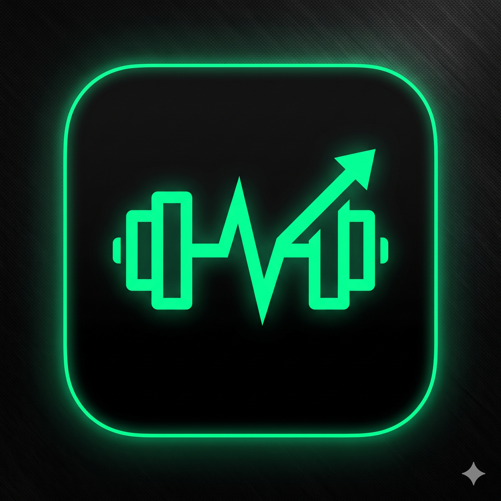

# FitAgent — Rule-Based Workout Planning & Performance Tracking Android App
<p align="center">
  
</p>

**FitAgent** (`com.FitAgent`) is a 100% offline-first, native Android workout planning, custom routine building, and progressive overload tracking application built in **Kotlin** using **Material Design 3** and **AndroidX Room Persistence Library (SQLite Version 4)**.

Designed with a high-contrast **True-Black (`#000000`) & Aura Green (`#00FF94`)** OLED interface, FitAgent eliminates gym logging friction, subscription paywalls, and internet connectivity dependencies by executing all workout generation algorithms, unit conversions, and relational analytics locally on the device.

<br>

## 1. Key Features

### 1.1 Biometric Onboarding & Live BMI Engine
- **Live BMI Calculation (`ProfileSetupActivity` & `UserProfile`)**: Dynamically computes Body Mass Index (`BMI = weightKg / (heightM * heightM)`) as the user types via `TextWatcher` and classifies into **Underweight** (`< 18.5`), **Normal** (`18.5 – 24.9`), **Overweight** (`25.0 – 29.9`), or **Obese** (`>= 30.0`).
- **Bidirectional Unit Converter (`UnitConverter.kt`)**: Supports instant one-tap toggling between `kg` ↔ `lbs` (`1 kg = 2.20462 lbs`) and `cm` ↔ `ft/in` while storing all biometric values canonically in metric (`cm` and `kg`) inside `SharedPreferences` to prevent floating-point rounding drift.
- **Locale-Aware Defaults**: Automatically detects the device's country code (`Locale.getDefault().country`) on first launch to set default measurement units.

<br>

### 1.2 Deterministic 4×4 Matrix Workout Generator
- **16 Rule-Based Workout Plans (`WorkoutGenerator.kt`)**: Synthesizes structured 5-exercise workout plans instantaneously by mapping **4 primary fitness goals** against **4 equipment availability tiers**:
  - **Fitness Goals (4)**: `Muscle Gain`, `Weight Loss`, `Build Endurance`, `General Fitness`
  - **Equipment Tiers (4)**: `No Equipment`, `Dumbbells Only`, `Full Gym`, `Resistance Bands`
- **Actionable Coaching Metadata**: Every generated exercise includes recommended sets, target reps or duration in seconds, target muscle group tags, and form tips.

<br>

### 1.3 Custom Routine Builder & 100-Exercise Catalog
- **100 Pre-Indexed Exercises (`ExerciseLibrary.kt`)**: Parcelable in-memory catalog (`MASTER_LIST`) spanning **7 anatomical muscle groups**:
  - **Chest** (15 exercises)
  - **Back** (15 exercises)
  - **Legs** (20 exercises)
  - **Shoulders** (12 exercises)
  - **Arms** (18 exercises)
  - **Core** (12 exercises)
  - **Cardio** (8 exercises)
- **Live Search & Chip Filtering (`ExercisePickerActivity`)**: Combines instant keyword search with 8 horizontal category filter chips (`All`, `Chest`, `Back`, `Legs`, `Shoulders`, `Arms`, `Core`, `Cardio`).
- **Custom Routine Persistence (`CreateRoutineActivity`)**: Configure custom routine titles, exercise sequence order, default sets, target weights, target reps, and coaching notes backed by foreign-key `ON DELETE CASCADE` persistence.

<br>

### 1.4 Multi-Modal Active Workout Logger & Haptic Rest Timer
- **3 Exercise Logging Modalities (`LoggerActivity` & `LoggerAdapter`)**: Dynamically renders specialized input columns based on `ExerciseType`:
  - `WEIGHTED` → **Set | Previous | Weight (kg/lbs) | Reps**
  - `BODYWEIGHT` → **Set | Previous | Reps**
  - `TIMED` → **Set | Previous | Seconds**
- **Inline Progressive Overload (`PREVIOUS` Column)**: Queries the last 20 historical logs per exercise (`getRecentLogsForExercise()`) and displays the previous session's weight and reps directly beside each active set.
- **60-Second Haptic Countdown Rest Timer**: Modal rest timer dialog (`dialog_rest_timer.xml`) with `-15s` / `+15s` quick adjustments, skip option, and a `500ms` hardware vibration alert (`VibratorManager` / `VibrationEffect`) upon completion.
- **Automatic Routine Template Sync**: Completing a workout launched from a custom routine automatically updates the routine's default set counts, weights, and `lastUsedAt` timestamp while preserving any unperformed exercises.

<br>

### 1.5 Progress Analytics, Streak Engine & Undoable History
- **Top 3 Personal Record Lifts (`HomeFragment`)**: Uses nested SQLite `TRIM(REPLACE(...))` string cleaning to strip `(Set 1)` through `(Set 10)` suffixes and rank the user's Top 3 most frequent exercises with their all-time best weight/reps or hold duration.
- **Consecutive Day Streak Engine (`ProgressFragment`)**: Parses session dates into normalized midnight epoch timestamps (`86,400,000 ms` intervals) sorted descending to accurately track consecutive daily training streaks.
- **Swipe-to-Delete with 5-Second Undo (`HistoryActivity`)**: `ItemTouchHelper` left/right swipe gesture with confirmation dialog and a 5-second `Snackbar` undo window before committing database deletion.

<br>

## 2. System Architecture & Database Schema (Room SQLite v4)

FitAgent follows a **Three-Tier Native Android Architecture**:

1. **Presentation Layer**: 10 `AppCompatActivity` controllers, 4 `Fragment` tabs hosted inside `MainActivity` via `BottomNavigationView`, and 8 `RecyclerView.Adapter` classes styled with Material Design 3 Dark tokens.
2. **Domain & Utility Layer**: Stateless Kotlin singleton services (`WorkoutGenerator`, `UnitConverter`, `ProfileManager`, and `ExerciseLibrary`).
3. **Persistence Layer (`AppDatabase.kt` — Room SQLite Version 4)**:
   - **`routines` Table**: `id (PK)`, `name`, `createdAt`, `lastUsedAt`, `isPrebuilt`
   - **`routine_exercises` Table**: `id (PK)`, `routineId (FK -> routines.id ON DELETE CASCADE)`, `exerciseName`, `muscleGroup`, `orderIndex`, `defaultSets`, `defaultReps`, `defaultWeight`, `unit`, `notes`
   - **`workout_sessions` Table**: `id (PK)`, `date`, `goal`, `equipment`, `duration`, `totalVolume`, `exerciseCount`, `routineId (FK Nullable)`
   - **`workout_logs` Table**: `id (PK)`, `sessionId (FK)`, `exerciseName`, `muscleGroup`, `sets`, `weight`, `reps`, `unit`, `volume`

<br>

## 3. Project Package Structure

```text
FitAgent/
├── app/
│   ├── build.gradle.kts
│   └── src/
│       ├── main/
│       │   ├── AndroidManifest.xml
│       │   ├── java/com/FitAgent/
│       │   │   ├── adapters/          # 8 RecyclerView Adapters (Logger, Routine, History, Picker, TopLift)
│       │   │   ├── data/              # ExerciseLibrary.kt (100 Master Exercises across 7 muscle groups)
│       │   │   ├── database/          # AppDatabase.kt (Room v4, Migrations 2->3 & 3->4), WorkoutDao, RoutineDao
│       │   │   ├── fragments/         # HomeFragment, WorkoutFragment, ProgressFragment, ProfileFragment
│       │   │   ├── models/            # Room Entities & Data Models (UserProfile, Exercise, Routine, WorkoutLog)
│       │   │   ├── utils/             # WorkoutGenerator.kt, UnitConverter.kt, ProfileManager.kt
│       │   │   ├── MainActivity.kt
│       │   │   ├── ProfileSetupActivity.kt
│       │   │   ├── EditProfileActivity.kt
│       │   │   ├── WorkoutPlanActivity.kt
│       │   │   ├── CreateRoutineActivity.kt
│       │   │   ├── ExercisePickerActivity.kt
│       │   │   ├── LoggerActivity.kt
│       │   │   ├── HistoryActivity.kt
│       │   │   ├── HistoryDetailActivity.kt
│       │   │   ├── SessionDetailAvtivity.kt
│       │   │   └── ProgressActivity.kt
│       │   └── res/
│       │       ├── drawable/          # Muscle group icons & custom UI backgrounds
│       │       ├── layout/            # 22 XML Material 3 Dark layouts & dialogs
│       │       ├── menu/              # bottom_nav_menu.xml
│       │       ├── values/            # colors.xml (#000000 & #00FF94), strings.xml, themes.xml
│       │       └── xml/               # backup_rules.xml & data_extraction_rules.xml
│       ├── test/                      # Local JVM Unit Tests (JUnit 4)
│       └── androidTest/               # Instrumented Android Tests (Espresso)
├── build.gradle.kts
├── settings.gradle.kts
└── gradle/libs.versions.toml
```

<br>

## 4. Technology Stack

| Layer / Category | Technology / Library | Version / Target |
| :--- | :--- | :--- |
| **Programming Language** | Kotlin (JVM Target 11) | `1.9.24` |
| **Build System** | Android Gradle Plugin (AGP) & KAPT | `8.5.2` |
| **Android SDK Support** | Min SDK `24` (Android 7.0) to Compile/Target SDK `36` | `API 24 – 36` |
| **UI & Design System** | Material Design 3, ConstraintLayout, RecyclerView, CardView | `1.11.0` / `2.1.4` |
| **Local Database ORM** | AndroidX Room (`room-runtime`, `room-ktx`, `room-compiler`) | `2.6.1` |
| **Concurrency & Streams** | Kotlin Coroutines (`kotlinx-coroutines-android`) & `Flow` | `1.7.3` |
| **Lifecycle Management** | AndroidX Lifecycle (`lifecycle-viewmodel-ktx`, `livedata-ktx`) | `2.7.0` |
| **Testing Frameworks** | JUnit 4, AndroidX Test Ext JUnit, Espresso Core | `4.13.2` / `3.5.1` |

<br>

## 5. Getting Started & Build Instructions

### Prerequisites
- **Android Studio** (Koala / Ladybug or newer)
- **JDK 11** or higher
- **Android Device or Emulator** running Android 7.0 (API 24) or higher

### Step-by-Step Build
1. **Clone the repository**:
   ```bash
   git clone https://github.com/<your-username>/FitAgent.git
   cd FitAgent
   ```
2. **Open in Android Studio**:
   - Select **File → Open** and choose the `FitAgent` project directory.
   - Wait for Gradle sync and KAPT annotation processing to complete.
3. **Compile and install the Debug APK**:
   ```bash
   ./gradlew assembleDebug
   ./gradlew installDebug
   ```
   The compiled APK is generated at `app/build/outputs/apk/debug/app-debug.apk`.

<br>

## 6. Author & Academic Credits

- **Student Developer**: Samyak Pradeep Gamre (Roll No. 19 | Exam Seat No. 510512906)
- **Course**: Third Year B.Sc. Computer Science (T.Y.B.Sc. CS — Semester V)
- **Project Guide**: Prof. Jagruti Raut, Department of Computer Science
- **College**: Bhaskar Waman Thakur College of Science, Yashvant Keshav Patil College of Commerce, Vidhya Dayanand Patil College of Arts (**VIVA College**), Virar (West) — Affiliated to **University of Mumbai**
- **Academic Year**: 2026–2027
